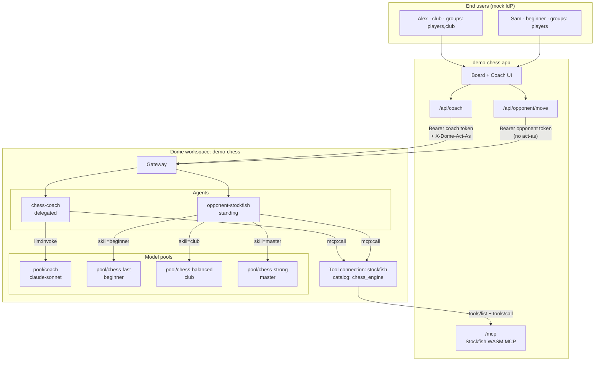
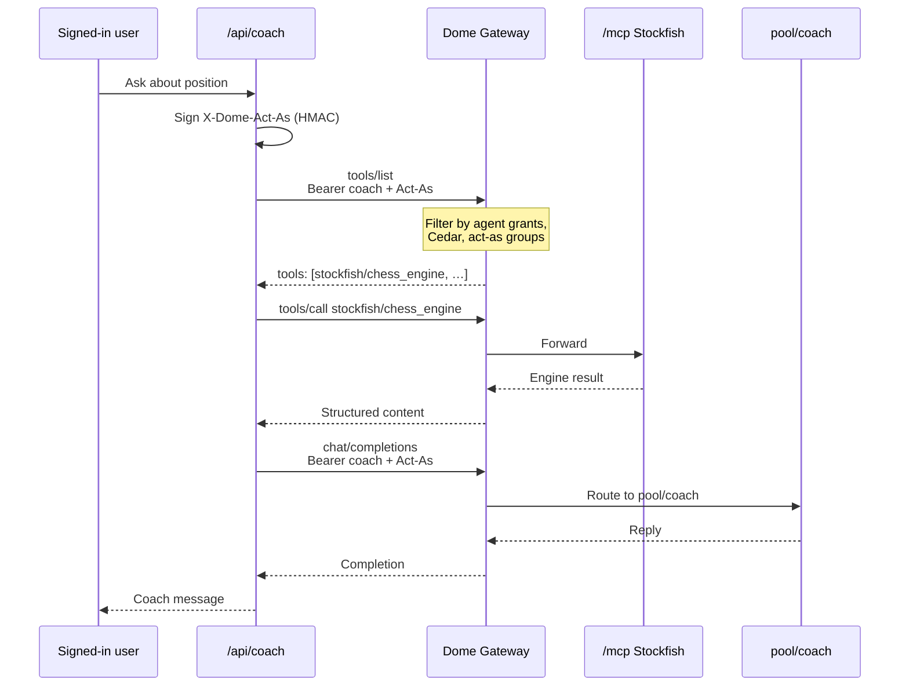

# demo-chess

**Chess Coach** — interactive · delegated + standing Dome example.

A playable chess app with an embedded board and a side coach. You play White; a standing opponent agent plays Black. Ask the coach questions mid-game — that coach runs as **you** (delegated / act-as).

| | |
|---|---|
| **Mode** | Interactive |
| **Identity** | Delegated coach + standing opponent |
| **Stack** | Next.js · Vercel-friendly |
| **Engine** | Stockfish — **wasm (Vercel)** · **local Docker** · **remote bridge** |

## Agents → Dome entities

Two agents share one board. Both go through the **Dome Gateway**; only the coach is delegated.

| App role | Dome agent | Identity | Model pool(s) | Tool |
|---|---|---|---|---|
| Coach | `chess-coach` | Delegated — HMAC `X-Dome-Act-As` (Alex / Sam) | `pool/coach` → Sonnet | **Discovered** via `tools/list` (typically `stockfish/chess_engine`) |
| Opponent | `opponent-stockfish` | Standing — agent token only | skill → `pool/chess-fast` \| `balanced` \| `strong` | **Discovered** via `tools/list` (same catalog, no act-as) |



### Opponent skill → model routing

| Skill (UI) | Dome model pool | Engine policy |
|---|---|---|
| Beginner | `pool/chess-fast` | Depth 6 · MultiPV 5 · often a secondary line |
| Club | `pool/chess-balanced` | Depth 12 · MultiPV 3 · rare slips |
| Master | `pool/chess-strong` | Depth 16 · best line only |

The standing opponent’s pool is chosen from **match skill**, not from who is signed in. Set `DOME_BROKER_URL` for a real Broker; otherwise `src/lib/dome-broker.ts` returns the same shape.

## How act-as works

**Act-as** lets a registered agent call the Gateway **on behalf of an end user**. Dome then evaluates policy, quotas, and tool allowlists against *agent + user*, not the agent alone.

| | Coach (`chess-coach`) | Opponent (`opponent-stockfish`) |
|---|---|---|
| **Pattern** | Delegated | Standing |
| **Principal** | Agent + signed-in user | Agent only |
| **Header** | `Authorization: Bearer <coach token>` **and** `X-Dome-Act-As: <HMAC>` | `Authorization: Bearer <opponent token>` only |
| **Who signs** | App signs with `DOME_ACTAS_SECRET` (`src/lib/actas.ts`) | — |
| **Identity payload** | `sub`, `email`, `groups` from the session (Alex / Sam) | — |
| **Why it matters** | Depth, coach tone, quotas, and audit attribution follow the user | Skill/model routing is independent of the player |

Flow for a coach question:

1. User signs in → mock IdP session (`src/lib/auth.ts`).
2. `/api/coach` builds an act-as identity from that session (`identityFromUser`).
3. HMAC-signs it into `X-Dome-Act-As` and calls the Gateway for:
   - `tools/list` → pick engine from what Dome exposes to this user
   - `tools/call` → that discovered name (engine brief)
   - `/v1/chat/completions` → `pool/coach` (prose)
4. Gateway verifies the signature against the secret registered on `chess-coach`, then applies rules/quotas for **that user**.

The opponent never sends act-as: Black is a fixed service agent. Changing login does not change how hard the opponent plays — only the skill picker (and thus the model pool) does.

## Coach prompts on agent metadata

Coach **voice** is stored on the `chess-coach` agent as Dome metadata — not in `auth.ts` (that file only keeps a fallback).

| Metadata key | When used | Act-as groups |
|---|---|---|
| `prompt.club` | Alex (club player) | includes `club` |
| `prompt.beginner` | Sam (beginner) | `players` without `club` |
| `prompt.default` | Fallback if a key is missing | — |

```bash
# Edit voice without redeploying the app
dome agents update chess-coach \
  --metadata demo=chess \
  --metadata role=coach \
  --metadata 'prompt.club=Terse and tactical…' \
  --metadata 'prompt.beginner=Plain language only…' \
  --metadata 'prompt.default=Helpful chess coach…'

# Refresh the committed snapshot the Next / Vercel app reads
./scripts/sync-coach-metadata.sh
# → config/coach-metadata.json (shipped) and .dome/coach-metadata.json (local)
```

`/api/coach` calls `resolveCoachPrompt()` (`src/lib/coach-prompts.ts`): map groups → metadata key → system prompt. Optional live path: set `DOME_API_URL` + `DOME_PLATFORM_TOKEN` (`agent.view`) to `GetAgent` instead of the snapshot.

## Quotas come from Dome

The app keeps **no** usage counter. Dome enforces spend caps per act-as subject and answers `429` (`llm: quota exceeded (act_as): spend cap reached`) when one is exhausted. `/api/coach` maps that to a coach message and flips the panel chip to *Dome cap reached*; everything else reports *Dome quota active*.

```bash
# Change the cap without touching app code
dome model quota list
dome model quota update <quota-id> --limit 10
```

Because the cap is per verified end user, Alex and Sam exhaust independently — and every browser signed in as Alex shares Alex's budget.

## Tool discovery (the norm)

Do **not** hardcode MCP tool names in env (there is no `DOME_STOCKFISH_TOOL`). Both agents:

1. `POST {gateway}/mcp` with `tools/list` (coach includes `X-Dome-Act-As`)
2. Pick `chess_engine` from whatever Dome returned (qualified as `stockfish/chess_engine`)
3. `tools/call` that name

Dome filters the list from agent grants + Cedar + verified act-as. Add or remove an
engine tool in the control plane and the app picks up the new catalog on its next
list without a redeploy.



## Dome local wiring

Follow the [interactive app tutorial](https://docs.domesystems.ai/tutorials/examples/interactive-agent)
to provision these resources in your own workspace.

| Resource | Name |
|---|---|
| Gateway | `Default` → `https://gateway.dev.domesystems.ai/gateways/…` |
| Agents | `chess-coach` (delegated, HMAC act-as) · `opponent-stockfish` (standing) |
| Pools | `pool/coach` · `pool/chess-fast` · `pool/chess-balanced` · `pool/chess-strong` |
| Tool | `stockfish` → `chess_engine` (app `/mcp`, via cloudflared or deployed URL) |
| Quotas | act-as `alex` $5/day · `sam` $2/day (enforced by Dome, not the app) |

```bash
# Context
dome context use <your-workspace>

# Secrets live in .env.local (gitignored). Restart Next after editing.
# Keep a tunnel up so Dome can reach Stockfish:
cloudflared tunnel --url http://127.0.0.1:<next-port>
dome tool update stockfish --url https://<tunnel>/mcp
dome tool catalog sync stockfish
```

Verified locally: coach replies via `pool/coach` + `stockfish/chess_engine` with act-as; opponent moves via `pool/chess-fast|balanced|strong` as standing.

## Quick start (no Docker)

```bash
cp .env.example .env.local   # STOCKFISH_MODE=wasm
npm install
npm run dev                  # http://localhost:3000
```

Stockfish.js runs inside the Next.js API — same path works on **Vercel Deploy**.

## Sign in

The app opens on a login screen backed by a mock identity provider
(`src/lib/auth.ts`). Two accounts, deliberately different:

| Login | Player | Level | Engine depth | Coach voice | Tools | Questions |
|---|---|---|---|---|---|---|
| `alex` / `alex` | Alex Rivera | Club player (1780) | 16 | Terse, concrete variations | `chess_engine` | 25 |
| `sam` / `sam` | Sam Doyle | Beginner (900) | 10 | Plain language, no jargon | `chess_engine` | 10 |

Sign in as each and ask the same question about the same position — the depth,
wording, and remaining question budget all differ. That difference is the point:
the coach is configured by **who the caller is**. The session cookie becomes
the act-as principal on every governed coach call.

## Stockfish modes

| Mode | When to use | Env |
|---|---|---|
| **wasm** | Local without Docker + Vercel | `STOCKFISH_MODE=wasm` |
| **local** | Real mcp-stockfish via Docker | `STOCKFISH_MODE=local` + compose |
| **remote** | Shared hosted mcp-stockfish | `STOCKFISH_MODE=remote` + `STOCKFISH_URL` |

See [STOCKFISH.md](./STOCKFISH.md).

### Docker local engine

```bash
docker compose up --build stockfish
# then in .env.local:
# STOCKFISH_MODE=local
# STOCKFISH_URL=http://localhost:8080
```

On the Dome path, both agents **discover** the engine via Gateway `tools/list`, then
`tools/call` the returned name (usually `stockfish/chess_engine` pointing at this
app’s `/mcp`). Docker/`STOCKFISH_URL` is only the fallback when Dome is unset.

## Status

- [x] Next.js board + coach UI
- [x] WASM Stockfish (Vercel / default)
- [x] Docker mcp-stockfish bridge (local / remote)
- [x] Mock auth (login screen, session cookie, per-user depth / tools)
- [x] Spend caps enforced by Dome Quotas per act-as subject (no app-side counter)
- [x] Standing opponent agent + skill-based model-pool routing
- [x] `/mcp` route (app-hosted Stockfish MCP for Gateway)
- [x] Dome workspace wiring (agents, gateway, pools, act-as, rules, quotas)
- [x] Session persistence (board + coach chat across refresh)
- [ ] Stable public MCP URL (named Cloudflare tunnel / Vercel domain)
